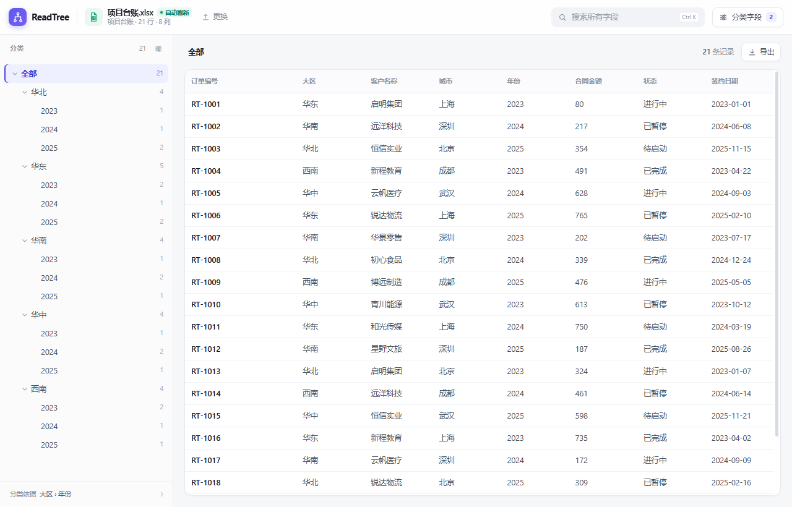

# ReadTree

把 Excel 表格按字段变成可浏览的分类树。包含一个带自动刷新的 Windows 桌面版，以及一个零安装的单文件网页版。

## 直接使用

### Windows 桌面版（推荐）

解压 ReadTree-Windows.zip，双击 ReadTree.exe。

- 用“选择文件”打开的文件，Excel 保存后会自动刷新；文件名旁会显示“自动刷新”。
- 会自动记住上次打开的文件，下次启动直接恢复。
- 拖入文件也可以查看，但拖入是一次性读取；需要自动刷新时用“选择文件”重新打开。
- 需要 Microsoft Edge WebView2 Runtime；Windows 10/11 一般已随 Edge 安装。
- 未签名的 exe 如果被 SmartScreen 拦截：更多信息 → 仍要运行。

### 单文件网页版

双击 ReadTree.html，用 Edge 打开，拖入 Excel。

网页版是完全离线的单文件版本，不依赖桌面壳；但它是一次性读取，Excel 保存后需要重新拖入。

## 功能

- 支持 .xlsx / .xls / .csv；自动跳过合并的标题行，向下填充合并单元格
- 日期统一显示为 YYYY-MM-DD，数字保留 Excel 的显示格式
- 自动推荐分类字段，也可以在“分类字段”里选择任意列、调整层级顺序、最多 5 层、按分隔符拆分多值
- 文件管理器式分类树：展开/折叠、节点计数、面包屑、方向键导航
- 全字段搜索，命中高亮，树和表格同步过滤
- 表格虚拟滚动，点行打开详情，支持上一条/下一条
- 当前分类导出 CSV（带 BOM，Excel 打开中文正常）
- 桌面版使用原生文件对话框，保存 Excel 后自动刷新
- 数据只在本机处理，不上传

## 关于桌面技术栈

Tauri 官方 Windows 构建要求 Rust + MSVC。当前开发机没有这两个工具链，安装体积很大，所以桌面壳使用 C# + WebView2 实现；Windows 上 Tauri 的渲染内核也是 WebView2，界面和交互一致，exe 约 1 MB。

前端仍是 React 19 + TypeScript + Vite。以后要在有 Rust/MSVC 的机器上套 Tauri，界面、解析、建树代码可以直接复用。

## 开发

需要 Node.js 20+ 和 pnpm。

    pnpm install
    pnpm dev
    pnpm build

构建产物是单文件 dist/index.html，也可以直接当网页版打开。

## 构建 Windows 桌面版

需要 .NET Framework 4.8 自带的 csc.exe，以及 WebView2 SDK（已放在 tools/webview2-sdk）。

    powershell -ExecutionPolicy Bypass -File desktop/build.ps1

产物在 desktop/build/ReadTree/，包含 ReadTree.exe 和 3 个依赖 DLL。

## 目录

    src/                 React 界面、Excel 解析、分类树
    desktop/             C# + WebView2 桌面壳
    samples/             示例台账
    release/             Windows 发布包
    tools/webview2-sdk/  WebView2 SDK

## 已知边界

- 表头取前 30 行中第一行有至少两个不同值的行；多行复合表头暂未支持
- 单个工作表上限 20 万行，受浏览器内存限制
- 旧版 .xls 以 BIFF8 为主；极老的 GBK 编码文件可能需要额外码表
- CSV 建议 UTF-8 编码（暂不支持 GBK 编码的 CSV）
- 桌面版的自动刷新只监听“选择文件”打开的路径；拖入文件是快照
- 不保存导入的数据；只记住分类字段配置和上次文件路径

## 第三方

- React 19 — MIT
- SheetJS 0.20.3 — Apache-2.0
- Microsoft.Web.WebView2 — Microsoft 许可
- Vite / vite-plugin-singlefile — MIT
